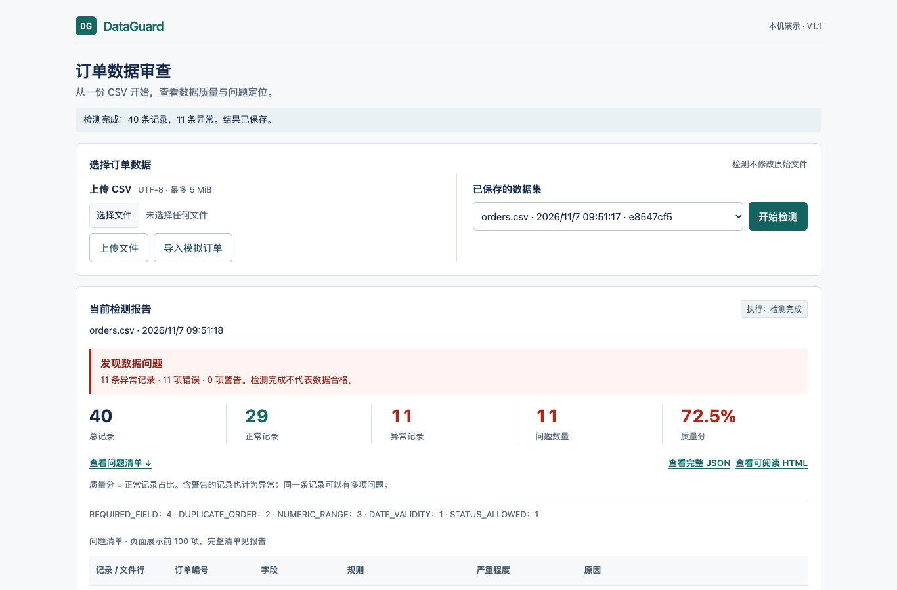

# DataGuard

订单 CSV 的数据质量检测工具。上传一份 CSV，按一组确定性规则逐条检查，给出能定位到具体行和字段的问题清单，并生成 JSON 和 HTML 报告。检测任务、失败记录和结果都会保存，服务重启后仍然可查。

技术栈：Java 21、Spring Boot 4.1.2、Jackson 3、JDBC，数据库用 H2（默认）或 MySQL，前端是原生 HTML/CSS/JS。

项目在 AI（Codex）辅助下完成，需求和取舍由我决定。



[手机端问题清单](docs/evidence/frontend-stage1/after-mobile-issues.png) · [前端修改前后对比](docs/frontend-stage1.md)

## 快速演示

需要 JDK 21、Bash、curl 或 wget、unzip（第一次运行要联网下载依赖）：

```bash
bash scripts/mvn.sh clean verify
bash scripts/run.sh
```

打开 http://127.0.0.1:8080，点“导入模拟订单”，再点“开始检测”，然后查看 JSON 或 HTML 报告。默认用 H2 文件库，不需要装 MySQL。数据在 `var/db`，上传的文件在 `var/uploads`，备份时两处要一起备份。

也可以用命令行：

```bash
bash scripts/run.sh inspect data/raw/orders.csv reports
```

内置样本是 40 条合成订单，不含真实个人信息。预期结果是 29 条正常、11 条异常、11 个问题，质量分 72.50%。

几点说明：
- 质量分 = 正常记录数 ÷ 总记录数。
- 一条记录可以触发多个问题，所以“问题数”和“异常记录数”不一定相等。
- 带警告（WARNING）的记录也算异常记录。
- 任务显示“检测完成”只表示检测跑完了，不代表数据合格。

规则包括：必填字段、重复订单（所有重复行都会标记）、数据类型、数值范围、日期是否真实存在、状态是否合法、跨字段的金额校验。字段定义见[数据字典](data/README.md)。

## 架构

```text
Controller（校验 HTTP 和 DTO）
  → Service（保存数据、执行检测任务）
    → QualityRule（可组合的规则接口）
      → Repository / JdbcTemplate
        → H2 或 MySQL：datasets、inspection_tasks、inspection_reports、quality_issues
```

- 报告、问题清单和成功状态在同一个事务里提交。失败的任务单独记录；服务启动时，上次遗留的 `RUNNING` 任务会被标为 `FAILED/INTERRUPTED`。
- 输入上限：文件 5 MiB、10000 条记录、单个字段 4096 个字符。问题数、诊断信息和报告大小也有上限，超限则整个任务失败。
- 检测不会修改原始 CSV。

## 测试

共 96 项 Java 测试，其中 6 项需要真实 MySQL。没有 MySQL 时它们会被跳过（本机是 90 通过、6 跳过）。CI 里用真实 MySQL 跑，并要求这 6 项零跳过，同时检查容器重启前后报告和文件是否仍可复用。浏览器端另有 23 项展示和交互检查，在本机 Chrome 上通过。

想在本机跑 MySQL 测试，先准备一个**专用的空库**（不要指向业务库），设置 `DATAGUARD_MYSQL_TEST_URL`、`DATAGUARD_MYSQL_TEST_USERNAME`、`DATAGUARD_MYSQL_TEST_PASSWORD` 后运行 `verify`。测试只清理自己写入的数据。应用连接 MySQL 时使用 `DATAGUARD_DB_URL` 等变量，并设置 `SPRING_PROFILES_ACTIVE=mysql`。

端到端演示检查（先启动服务）：

```bash
python3 scripts/demo-check.py create --state .setup/demo-state.json
# 停止并重启同一个服务后：
python3 scripts/demo-check.py verify --state .setup/demo-state.json
```

它会验证成功的报告、无效路径、空文件的失败记录、失败任务的报告返回 409，以及重启后报告和文件能否继续使用。断电恢复和备份还原不在验证范围内。

CI 结果见 [GitHub Actions](https://github.com/wuyi060531-del/dataguard/actions)，验收细节见 [VALIDATION](docs/VALIDATION.md)。

## Docker

仓库带有 Dockerfile、Compose 配置和 GitHub Actions。使用方式：复制 `compose.env.example` 为 `.env`，填入两组不同的随机密码，然后：

```bash
docker compose up --build --wait
docker compose down   # 停止服务，保留数据卷
```

不要把 `.env` 提交到仓库。容器以非 root 用户和只读根文件系统运行，端口只映射到本机，健康检查会访问依赖数据库的 API。

## 限制

- 只支持单机、单用户、单实例。没有登录认证、定时任务、水平扩展，也没有 AI 接口。**不要直接部署到公网。**
- 页面的问题清单目前只展示前 100 项，完整清单在 JSON 和 HTML 报告里。
- 依赖安全：Spring 的两项临时例外已随 Framework 7.0.10 升级移除，96 个解析出的依赖经 OSV 查询没有已知漏洞。详情和范围见 [SECURITY.md](SECURITY.md)。这是一个展示工程设计的项目，不是经过生产安全评估的平台。

## 文档

[API 与错误示例](docs/API.md) · [架构](docs/architecture.md) · [演示与截图](docs/DEMO.md) · [安全说明](SECURITY.md) · [验收记录](docs/VALIDATION.md) · [第三方依赖](docs/THIRD_PARTY_REVIEW.md)

## 许可证

尚未选择许可证，在选定之前不授予任何使用、修改或分发权限。依赖的许可见[第三方依赖](docs/THIRD_PARTY_REVIEW.md)。
