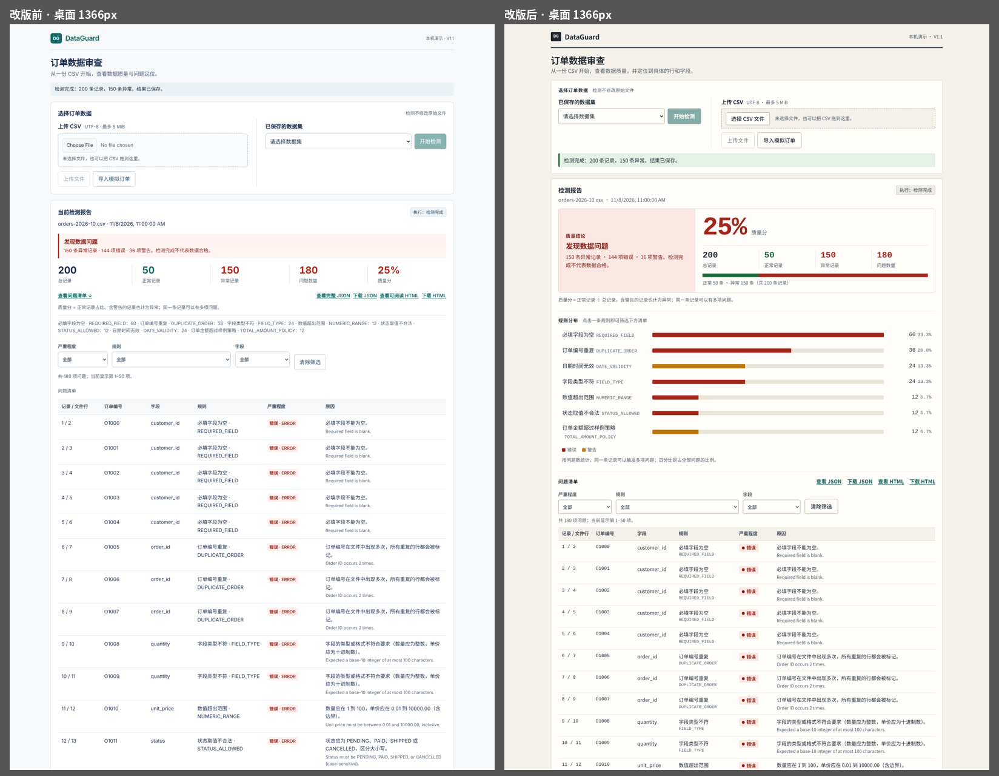
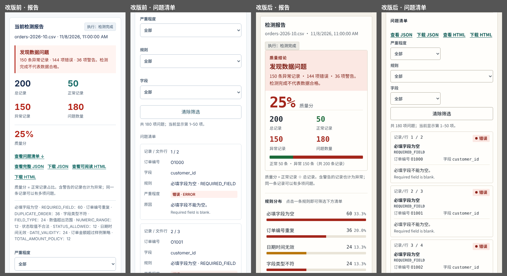
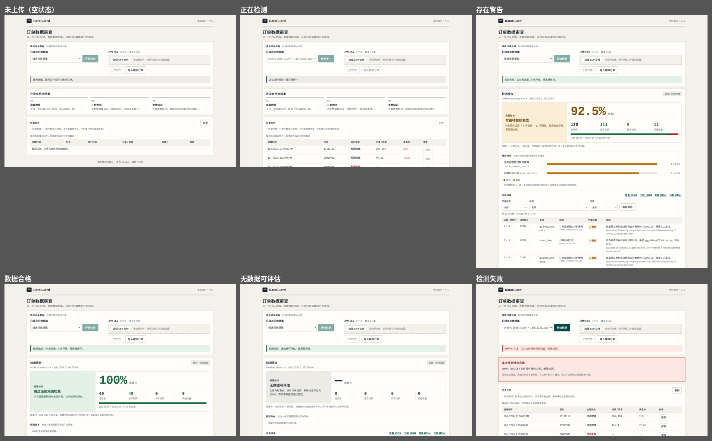
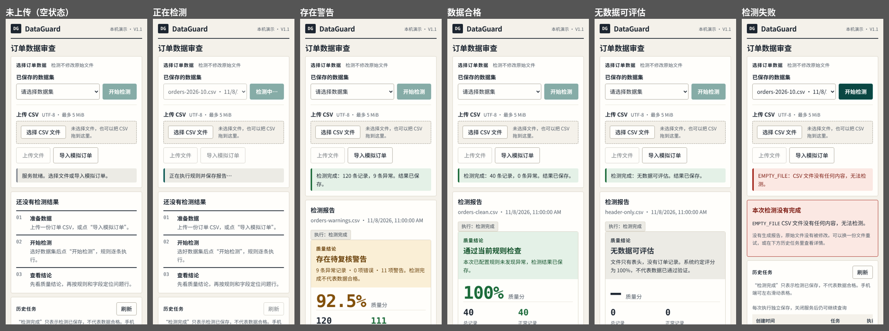

# 前端改版记录：浅色数据审查工作台

这一轮只改了原生 HTML/CSS/JS 和独立 HTML 报告的展示，没有改 Controller、Service、Repository、规则、DTO、SQL 和评分公式。筛选、分页、失败反馈和下载交互见文末的后续验收。

## 实际截图与测量

截图来自本机隔离的 H2 库、合成订单和真实的 Chrome 156，不是设计稿。桌面 1366×900，手机模拟 390×844。截图里没有浏览器账号栏或本机路径。

| 内容 | 修改前 | 修改后 |
| --- | --- | --- |
| 桌面首屏 | [前](evidence/frontend-stage1/before-desktop.png) | [后](evidence/frontend-stage1/after-desktop.png) |
| 手机顶部 | [前](evidence/frontend-stage1/before-mobile-top.png) | [后](evidence/frontend-stage1/after-mobile-top.png) |
| 手机报告概览 | [前](evidence/frontend-stage1/before-mobile-overview.png) | [后](evidence/frontend-stage1/after-mobile-overview.png) |
| 手机问题列表 | [前](evidence/frontend-stage1/before-mobile-issues.png) | [后](evidence/frontend-stage1/after-mobile-issues.png) |
| 手机独立 HTML | [前](evidence/frontend-stage1/before-mobile-html.png) | [后](evidence/frontend-stage1/after-mobile-html.png) |
| 零记录 | [前](evidence/frontend-stage1/before-zero-records.png) | [后](evidence/frontend-stage1/after-zero-records.png) |
| 仅 WARNING | [前](evidence/frontend-stage1/before-warning-only.png) | [后](evidence/frontend-stage1/after-warning-only.png) |

| 测量 | 修改前 | 修改后 |
| --- | --- | --- |
| 桌面报告距页面顶部 | 683.81px | 437.13px |
| 手机订单编号单元格宽度 | 40.38px | 302px（值与标签位于同一完整条目） |
| 390px 独立 HTML 整页宽度 | 501px | 390px |

独立 HTML 报告保留完整的表格和原始快照，横向内容放在可用键盘聚焦的局部滚动容器里，而不是隐藏溢出的部分。手机端的问题条目保留原来的表头，并在每个值前标出字段名。桌面首屏包含当前文件、执行状态、质量结论、五项指标和问题清单入口。

## 展示语义和回归

- “执行：检测完成”只表示任务跑完并保存成功，用中性色，与错误、警告和“通过检查”分开。
- 错误用红色、警告用琥珀色，同时配有文字说明。“异常记录”和“问题数量”仍是两个不同的数。
- 零记录时显示“无数据可评估”，质量分显示“—”，历史显示“未评估”，并说明 API 返回的 100% 是系统约定；后端 JSON 和评分不变。
- 40 条样本的结果不变：29 正常、11 异常、11 个问题、72.50%，原始文件没有被修改。
- 新增 2 项 JUnit 测试，覆盖“无问题”“有错误”“有警告”的展示；原有的零记录和输出转义断言保留并有所加强。

实际执行：

| 验证 | 结果 |
| --- | --- |
| 修改前 `bash scripts/mvn.sh -o -B -ntp clean verify` | 94 项：88 通过、6 MySQL 跳过，0 失败/错误 |
| 修改后同一命令 | 96 项：90 通过、6 MySQL 跳过，0 失败/错误 |
| 修改前的浏览器基线 | 7 项数据和流程检查通过，同时记录了已知的布局缺陷 |
| 修改后的浏览器检查 | 23 项通过：[完整结果](evidence/frontend-stage1/after-checks.json) |
| Python 工具回归 | 21 项通过，含新增截图白名单与伪装 PNG 拒绝测试 |
| 安全检查脚本及其自检 | 通过（文本检查不能代替完整的漏洞或图片隐私审计） |

浏览器检查覆盖：正常样本、零记录、仅警告、无问题、空文件失败、中文文件名、超长标识和 HTML 注入文本；检查页面宽度、标识是否完整、质量结论的表述、JSON 里的分数，以及页面是否有未处理的 JS 异常。所有状态都来自真实的 HTTP 和 JDBC 操作，没有 Mock API。这次没有重新跑本机的 MySQL 和 Docker。

## 复现浏览器检查

只在隔离的演示环境里运行：脚本会创建合成数据集和任务，不要把 base-url 指向正式数据库。不需要安装前端框架，Python 依赖放在被 Git 忽略的虚拟环境里：

```bash
python3 -m venv .setup/ui-check-venv
.setup/ui-check-venv/bin/python -m pip install websocket-client==1.9.0
bash scripts/mvn.sh clean verify
```

在另一个终端启动隔离的服务（保持运行，结束后按 Ctrl+C）：

```bash
JAVA_TOOL_OPTIONS='-Xmx256m -XX:ActiveProcessorCount=2' \
DATAGUARD_DB_PATH="$PWD/.setup/ui-stage1-demo/db/dataguard" \
DATAGUARD_STORAGE_ROOT="$PWD/.setup/ui-stage1-demo/uploads" \
DATAGUARD_IMPORT_ROOT="$PWD/data/raw" PORT=18098 bash scripts/run.sh
```

用独立的配置目录启动本机 Chrome，不连接你平时的浏览器会话：

```bash
"/Applications/Google Chrome.app/Contents/MacOS/Google Chrome" \
  --headless=new --remote-debugging-port=0 \
  --user-data-dir="$PWD/.setup/ui-stage1-chrome" \
  --no-first-run --no-default-browser-check --disable-background-networking about:blank
```

在第三个终端运行（输出保存到被忽略的目录，不会覆盖仓库里的截图）：

```bash
.setup/ui-check-venv/bin/python scripts/check-ui-stage1.py \
  --base-url http://127.0.0.1:18098 \
  --cdp-port "$(head -1 .setup/ui-stage1-chrome/DevToolsActivePort)" \
  --output .setup/ui-stage1-recheck --fixtures .setup/ui-stage1-fixtures --phase after
```

脚本要求自己创建的 API 任务与真实页面一致。`--phase before` 只用于旧版本的基线，不能代替新版的检查。手机端是 Chrome 模拟，没有在真机 Safari、屏幕阅读器下测过，也没有做完整的 WCAG 验证。CI 里不包含这个本地 Chrome 脚本。

## 截图与已知限制

本阶段的 14 张 PNG 都来自隔离环境里的合成数据，逐张确认过文件名和内容，没有个人资料、凭据或数据库。图片需要人工看过，文本检查脚本扫不了图片里的隐私信息。

## 问题清单的后续改动（筛选、分页、中文原因）

在上面的改版之后，问题清单增加了：按严重程度、规则、字段筛选，每页 50 项的分页（不再只展示前 100 项），规则的中文名称和说明（英文原始原因保留在下方），失败信息出现在视口内并用 `role="alert"` 播报，断网时给出中文提示，忙碌时同时锁定数据集选择和文件输入，以及 JSON/HTML 报告的下载链接。后端接口、规则和评分都没有改。

2026-11-07 在 macOS arm64 用 JDK 21、全新 H2 文件库、独立上传目录和回环端口 18098 启动真实后端。Chrome 156 使用临时浏览器配置。两张新截图来自这次运行，已替换此前的桩 API 截图。

| 本机检查 | 结果 |
| --- | --- |
| `bash scripts/mvn.sh -o -B -ntp clean verify` | 96 项：90 通过，0 失败/错误，6 项 MySQL 测试跳过 |
| `scripts/check-ui-stage1.py --phase after`（其余参数按上节传入） | 23 通过，0 失败/跳过；[脚本原始结果](evidence/frontend-issues/stage1-after-checks.json) |
| 真实问题清单及停服检查 | 12 通过，0 失败/跳过；[测量与断言结果](evidence/frontend-issues/findings-checks.json) |

通过网页操作上传合成 CSV（`POST /api/datasets`）、执行检测（`POST /api/tasks`），用真实报告接口逐项比对页面。输入含 121 行缺少状态列的订单、1 行金额警告和 1 行数量越界，后端返回 123 项问题。未筛选分页为 50 / 50 / 23；按严重程度、规则和字段筛选 CSV 列数问题后为 50 / 50 / 21，最后一条 `SYN-121` 可见。中文“CSV 列数不符”和接口原始英文原因同时显示；矛盾条件给出无结果提示。

停止隔离后端后，用 Enter 激活“刷新”。错误提示在当前视口内，带 `role="alert"`，焦点落在提示上。修复前用鼠标触发时焦点回到页面主体；现在仅在焦点仍在触发控件或已丢到页面主体时移动焦点。1366×900 和 390×844 的整页宽度分别为 1366 / 1366 与 390 / 390（滚动宽度 / 视口宽度），无未处理 JS 异常。

截图：[桌面](evidence/frontend-issues/desktop-findings.png) · [手机](evidence/frontend-issues/mobile-findings.png)。本轮没有重跑本机 MySQL、Docker 或真机浏览器；原始记录的展开查看仍未实现。

## 第二轮前端改进

- 上传：选文件或拖拽 CSV 到上传区后，页面立即显示文件名和大小；不是 .csv 或超过 5 MiB 时在上传前提示，并禁用“上传文件”。上传成功后清空文件选择。
- 结果：打开报告后焦点移到“当前检测报告”标题；历史表中当前报告所在行高亮并带 `aria-current`；规则汇总同时显示中文规则名。翻页后若问题清单顶部已滚出视口，会回到清单顶部。
- 可访问性：增加“跳到主要内容”链接；表头加 `scope="col"`；任务执行期间主区域标记 `aria-busy`；尊重“减少动态效果”设置。

验证范围：用一个只返回合成数据（150 条问题）的本地桩服务，在 Chromium 的 1366px 和 390px 视口下检查了上述行为、原有的分页和筛选、离线失败提示，均无脚本错误、无横向滚动。**没有对真实 Java 后端重跑浏览器检查**；后端未改动，Java 测试由 CI 运行。

## 第三轮：整体视觉改版

只改 `static/` 下的 HTML、CSS、JS，没有改 Java 后端、API、数据库和业务规则，也没有引入框架或外部字体。

- **层次：** 质量结论和质量分是页面的视觉中心（结论色块 + 大号质量分），总记录、正常、异常、问题数是次级数字，下面是正常/异常记录比例条。“执行：检测完成”单独成一个标签，与“质量结论”分开，描述里仍写明检测完成不代表数据合格。
- **规则分布：** 每条规则一行，条形图区分错误和警告，数字来自报告的 `issuesByRule`，百分比是占全部问题的比例。每一行是按钮，点击后筛选下方清单并同步“规则”下拉框，再点一次取消；用键盘（Tab、Enter）也能操作。
- **问题清单：** 行更紧凑；规则列显示中文名，英文代码放在下一行；严重程度用形状加文字（圆点 = 错误，三角 = 警告），不只靠颜色。手机端每条问题是两行信息加原因的小卡片。
- **上传：** 用统一样式的“选择 CSV 文件”和拖拽区；原生文件输入仍然存在并可聚焦，键盘焦点会显示在上传区上。
- **状态：** 未上传（空状态引导）、正在检测（状态栏与按钮显示“检测中…”）、检测成功、数据不合格、仅有警告、无数据可评估、检测失败（独立的失败说明）都有对应展示。
- **配色与字体：** 暖色纸张底、深墨色文字、一个主色（只用于品牌和主按钮），通过/警告/失败各有独立的状态色；使用系统中文字体和系统等宽字体显示数字。主要文字对比度均不低于 5.3:1。没有深色模式。






**验证范围（请如实理解）：** 这一轮的截图和浏览器检查用的是本地静态服务加模拟 API（合成数据），在 Chromium 的 1366px 与 390px 下完成，没有连接真实的 Java 后端，也没有在 Chrome 真机、Safari 或屏幕阅读器上测试。已检查：规则分布与问题清单的筛选一致、分布数字之和等于问题总数、键盘操作、无横向滚动、无脚本错误，以及上一轮的分页、筛选和离线提示没有退化。`scripts/check-ui-stage1.py` 依赖真实后端，这次没有重跑。
